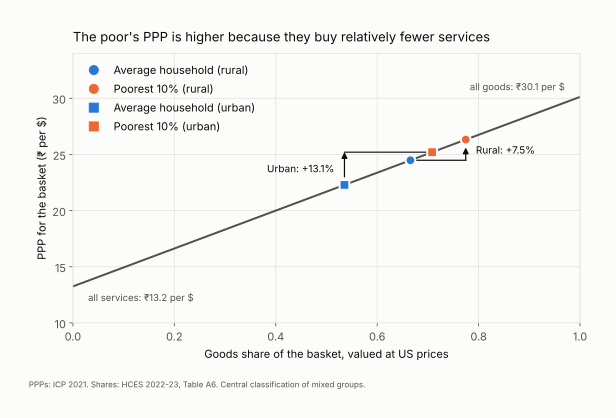

# poverty-ppp

A Lean 4 formalisation of one claim in the debate over India's poverty numbers: that the PPP used to convert the international poverty line into rupees is built on the average Indian's basket, not the poor's, and so understates the poor's cost of living.

## Summary

A long-standing criticism of the World Bank's PPP-based poverty line is that the PPP is weighted by the average consumer's basket, not the poor's.

Deaton and Dupriez (2011) estimate PPPs for the poor directly.
Arun Kumar recently [restated the criticism for India](https://thewire.in/economy/in-india-poor-are-less-poor-because-they-earn-little): the poor buy mostly essentials and few of the services that low wages make cheap, so the PPP makes them look less poor.

I prove that the poor's PPP is above the official PPP whenever the poor spend relatively more on goods and goods are relatively dearer than services, compared with the US.

The gap has a simple form:

$$\text{PPP}_{\text{poor}} - \text{PPP}_{\text{avg}} = (w_{\text{poor}} - w_{\text{avg}}) \times (r_g - r_s)$$

where $w$ is a basket's goods share valued at US prices, and $r_g$ and $r_s$ are the rupees per dollar's worth of goods and of services.

A rough back-of-the-envelope calculation suggests that the PPP, and so the poverty line, is about 7% higher for the poor in rural India and 13% higher in urban India.

## Chart



A basket's PPP is a straight line in its goods share, running from the services price ratio (₹13.2 per $) to the goods price ratio (₹30.1 per $).
The poorest 10% sit further up the line than the average household.
The vertical gap between them is the goods-share gap times the slope.

## The argument

1. `official_lt_poor`: the official line is below the poor's line if services are relatively cheaper than goods (compared with the US) and the poor's basket is more goods-heavy than the average basket.
2. Both conditions hold: goods cost about ₹30 per dollar's worth and services about ₹13 (ICP 2021), and the poorest 10% spend 85–89% on goods against 72–82% for the average household (HCES 2022-23).
3. Plugging these in, the poor's PPP is about 7.5% higher in rural India and 13% higher in urban India.

## Theorems

All in `PovertyPPP.lean`, namespace `PPP`, with shares valued at US prices.

| Theorem | Statement |
|---|---|
| `pppRate_eq_sum_shares` | A basket's PPP is the share-weighted average of the goods and services price ratios |
| `pppRate_eq_affine` | A basket's PPP is the services ratio plus the goods share times (goods ratio − services ratio) |
| `localLine_self` | Converting with the poor's own basket's PPP gives exactly what that basket costs in India |
| `official_lt_poor` | Under the two conditions, the official line is below the poor's line |
| `pppRate_gap` | PPP gap = goods-share gap × (goods ratio − services ratio) |
| `localLine_gap` | Line gap in rupees = PPP gap × the line in PPP dollars |

## Calibration and validation

| Central case | Rural | Urban |
|---|---|---|
| Goods share, poorest 10% (at Indian prices) | 89% | 85% |
| Goods share, average household | 82% | 72% |
| PPP, average household | ₹24.48 per $ | ₹22.29 per $ |
| PPP, poorest 10% | ₹26.32 per $ | ₹25.20 per $ |
| Gap | +7.5% (2.5–11.1%) | +13.1% (9.6–15.9%) |

`calibrate.py` revalues the shares at US prices before applying the formula.
The ranges come from classifying medical, conveyance and entertainment spending as all services, partly goods (central case) or all goods.

Our average-basket PPP is within 1.3% of the ICP's PPP for household consumption without housing (₹22.58 per $) for urban India, and 8.4% above it for rural India.
The comparison excludes housing because HCES spending excludes imputed rent.

`PovertyPPP.lean` also checks a worked example with `norm_num` on every build.
With goods at ₹30, services at ₹13, and baskets that are 78% and 67% goods, the poor's PPP is ₹26.26 against ₹24.39, and the rupee line is ₹187 higher with the poor's own basket.

## Limitations

- The PPP is a fixed basket in two categories, not the ICP's GEKS-Fisher method.
- One goods ratio and one services ratio are used for every basket, though the poor's mix within each category differs.
- Prices are from 2021 and shares from 2022-23.

## Files

| File | Contents |
|---|---|
| `PovertyPPP.lean` | Definitions, theorems and the worked example |
| `shares.py` | Goods and services shares by fractile class |
| `calibrate.py` | Price ratios, PPPs, the gap and the ICP check |
| `chart.py` | Draws `ppp_chart.svg` and `ppp_chart.png` |
| `Table_A6.xlsx` | HCES 2022-23 Table A6, as published by MoSPI |

## Build

```bash
lake exe cache get && lake build
pip install -r requirements.txt && python3 calibrate.py && python3 chart.py
```

## Sources

- Arun Kumar, [In India, Poor Are Less Poor Because They Earn Little](https://thewire.in/economy/in-india-poor-are-less-poor-because-they-earn-little), *The Wire*, 4 November 2026.
- World Bank, [International Comparison Program 2021, detailed results](https://databank.worldbank.org/embed/ICP-2021-Cycle/id/3a11040d?inf=n).
- MoSPI, [Household Consumption Expenditure Survey 2022-23, NSS Report 591](https://www.mospi.gov.in/sites/default/files/publication_reports/Report_591_HCES_2022-23New.pdf), Table A6.
- Angus Deaton and Olivier Dupriez, "Purchasing Power Parity Exchange Rates for the Global Poor", *American Economic Journal: Applied Economics* 3(2), 2011, pp. 137–166.

## Authorship

I chose the model, the units design and the scope, and wrote the Lean definitions and proofs.
Claude helped me work out the argument, suggested the proof structures, wrote the Python scripts and the Lean examples, and drafted parts of this README.

## Contact

Sayyad Irfan Ali | irfan@irfanali.org

## License

[MIT](LICENSE)
